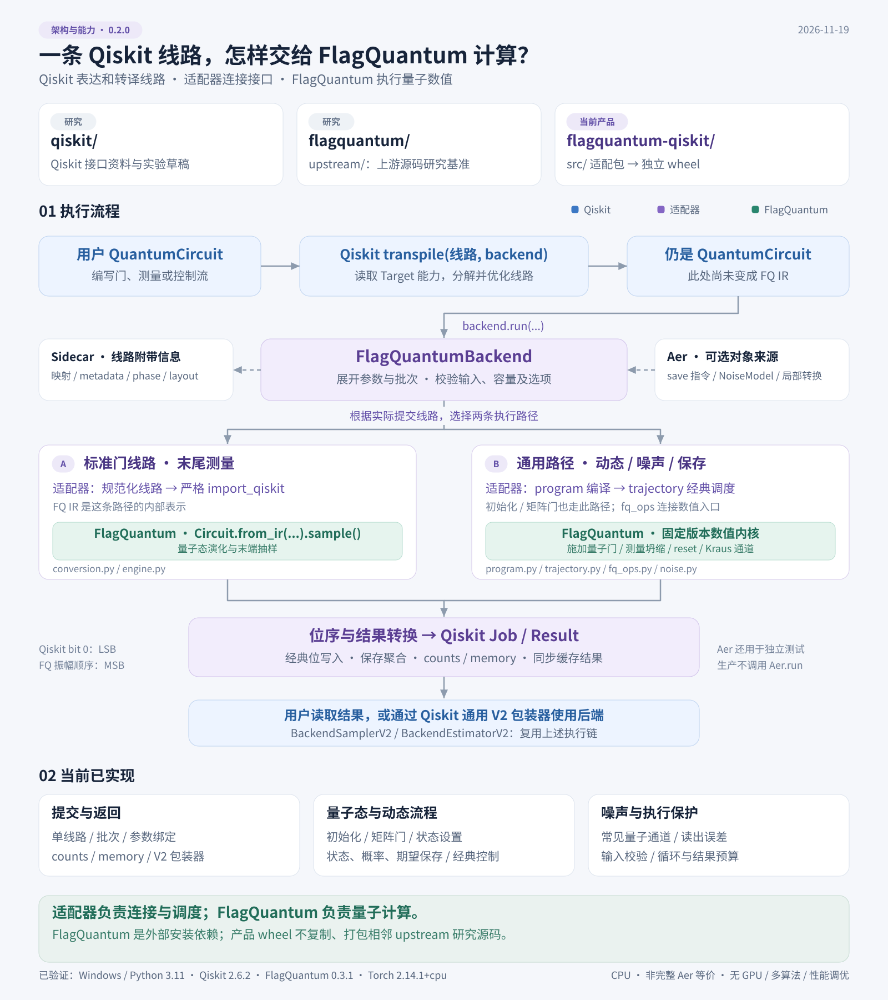

# FlagQuantum Qiskit 后端

`flagquantum_qiskit.FlagQuantumBackend` 是独立的 Qiskit BackendV2 包。Qiskit 负责线路表达和转译，真实 FlagQuantum 负责量子数值；结果使用 Qiskit Job / Result。当前版本 **0.2.0（2026-11-19）**，基础 Aer 功能对标与实际验证见 [兼容矩阵](COMPATIBILITY.md) 和 [验证记录](VALIDATION.md)。它不是完整 Aer 平替，也不注册 `AerSimulator(method="flagquantum")`。

## 阅读导航

| 目的 | 入口 |
| --- | --- |
| 浏览产品介绍、代码示例与交互流程 | [HTML 产品主页](site/index.html)（可直接本地打开） |
| 项目汇报：目标、使用、执行过程、结构与功能边界 | [完整项目介绍](site/report.html) |
| 演示版项目汇报 | [演示页面](site/presentation/index.html) |
| 直观看整体结构 | [架构图 SVG](docs/architecture.svg) |
| 看懂 13 个源码文件如何配合 | [主控调用关系](docs/source-map.svg) / [执行模块协作](docs/source-execution.svg) |
| 运行第一个线路 | 下方标准示例、[examples/bell.py](examples/bell.py) |
| 查看当前功能及限制 | [COMPATIBILITY.md](COMPATIBILITY.md) |
| 理解模块与数值边界 | [ARCHITECTURE.md](ARCHITECTURE.md)、[ADR-002](ADR-002-basic-aer-compatibility.md) |
| 检查真实验收证据 | [VALIDATION.md](VALIDATION.md)、[测试导航](tests/README.md) |
| 维护实现 | [AGENTS.md](AGENTS.md)、[包配置](pyproject.toml)、[源码](src/flagquantum_qiskit/) |



## 标准使用方式

```python
from qiskit import QuantumCircuit, transpile
from flagquantum_qiskit import FlagQuantumBackend

backend = FlagQuantumBackend()
circuit = QuantumCircuit(2)
circuit.h(0)
circuit.cx(0, 1)
circuit.measure_all()
compiled = transpile(circuit, backend)
print(backend.run(compiled, shots=1000).result().get_counts())
```

支持单线路/批次、`memory=True`、Aer 风格 `parameter_binds`、初始化/矩阵门、状态/概率/期望保存、reset/中途测量/经典控制流、常见量子与读出噪声，以及 Qiskit 通用 BackendSamplerV2 / BackendEstimatorV2。无输出线路允许执行并返回空数据，不隐式添加测量。有经典寄存器与显式输出时遵守经典位初始化为0、后写覆盖前写。

```python
from qiskit.primitives import BackendSamplerV2, BackendEstimatorV2
sampler = BackendSamplerV2(backend=backend)
estimator = BackendEstimatorV2(backend=backend)
result = backend.run([compiled, compiled], shots=100, memory=True,
                     seed_simulator=7).result()
print(result.get_memory(0))
```

Aer 的 `save_statevector` / `save_probabilities` / `save_expectation_value` / `set_statevector` 扩展方法和 `NoiseModel` 对象需要可选 `aer` extra。它仅提供指令/噪声对象和局部通道表示转换；生产不调用 Aer 模拟器。保存的 Statevector 是包装 FQ 计算结果的容器，不以 Qiskit 演化线路。

## 安装与验证

实际验证环境为 Windows / Python 3.11 / Qiskit 2.6.2 / 官方 FlagQuantum 0.3.1 Windows ABI3 wheel / Torch 2.14.1+cpu；Aer 对照版本固定0.18.4。其他平台与依赖版本没有验证。私有 FQ 数值入口严格检查0.3.1版本，不能未经验收升级。以下已验证平台的安装使用发布依赖，不需要另克隆上游源码、CUDA 或原生编译。

克隆本仓库后，在仓库根目录打开 PowerShell。以下是新环境的源码安装流程；已有可用环境无需重建。先安装固定 CPU 版 Torch，再安装本项目。

仓库地址：[shenzh21/flagquantum-qiskit](https://github.com/shenzh21/flagquantum-qiskit)。私密仓库需要账号具备访问权限；可先运行 `git clone https://github.com/shenzh21/flagquantum-qiskit.git`，再 `cd flagquantum-qiskit`。

```powershell
# 当前目录应含 pyproject.toml、src/ 和 examples/
py -3.11 -m venv .venv
.venv\Scripts\python.exe -m pip install --upgrade pip
.venv\Scripts\python.exe -m pip install torch==2.14.1+cpu --index-url https://download.pytorch.org/whl/cpu
.venv\Scripts\python.exe -m pip install .
.venv\Scripts\python.exe examples\bell.py
```

需要保存指令或 NoiseModel 对象时，将项目安装命令换成 `.venv\Scripts\python.exe -m pip install ".[aer]"`。开发者修改源码、执行测试或重新构建时，改用下面的 editable 安装；普通 `pip install .` 安装的是构建快照，不会自动读取之后的源码修改。

```powershell
# 在 flagquantum-qiskit 项目根目录执行
.venv\Scripts\python.exe -m pip install -e ".[test]"
.venv\Scripts\python.exe -m pip install "setuptools>=77" wheel
.venv\Scripts\python.exe -m pytest -q
.venv\Scripts\python.exe -m build --wheel --no-isolation
```

普通终端测量、动态控制和 V2 wrappers 不需要 Aer。源码安装的可选 extra 为 `.[aer]` 和 `.[test]`；`test` 不包含全部构建工具，所以使用 `--no-isolation` 构建前需要上面的 setuptools/wheel 安装步骤。仓库不包含虚拟环境或下载缓存，初次安装需要访问依赖索引；离线安装须由使用者预先准备与其平台匹配的完整依赖。

构建命令会生成 `dist/flagquantum_qiskit-0.2.0-py3-none-any.whl`；`dist/` 是本地构建目录，不要求仓库预先包含 wheel。已另行取得 wheel 时，也可用 `pip install <wheel路径>` 安装。历史交付的目录外 smoke 证据见验证记录；其中的原机器路径只描述当时环境，不是当前安装要求。

仓库文档与产品主页在构建后继续维护；已有 wheel 的 METADATA 保留构建时 README 快照，不随文档修改自动更新。2026-11-19 的累计190项用例是历史验证；2026-11-23 独立仓库整理不构成这些用例重新通过的证明，也不发布新的产品版本。

**独立仓库新验证（2026-11-23）：**从 Git 快照 `c289a6d7eb5da9a3baf9de84b47043092120fc40` 导出干净目录，完整测试 **190 passed in 42.29s**，0失败/0跳过；该快照构建 wheel 并安装到独立目标目录后，目录外 Bell 与动态线路 smoke 通过。使用现有已验证依赖环境，没有重新证明任意平台的全新依赖安装。见 [本次仓库验证记录](tests/results/repository_validation_2026-11-23.json)。本段是验证后的文档补充，不属于该 wheel 内嵌的 README 快照，也不替换历史记录。

## 选项与边界

- `num_qubits=20` 是容量上限（最多24），不为小线路补齐20位；不是性能保证。
- `max_memory_mb=256` 是保守预检与保存结果累计预算，不是操作系统强制峰值上限。批次结果总量、第三方临时分配仍需调用者合理控制。
- `precision="double"` 或 `"single"`、`device="cpu"`、正整数 `shots`（最多1,000,000）、`seed_simulator`；run 覆盖不改变默认值。
- `max_loop_iterations=10000` 限制每shot累计循环和预编译for展开，防无限循环/展开。未支持的选项与表达式明确拒绝。
- seed 在本工具及固定版本内可复现，不承诺与 Aer 的相同随机序列或相同 Kraus 轨迹。
- GPU、多算法、梯度、density-matrix输出、分布式与性能调优不在本轮。完整细节见兼容矩阵。

`job.circuit_sidecar` 返回副本，保留提交线路的测量映射、metadata、相位与layout。动态测量记录是静态词法顺序，不冒充某个shot实际分支轨迹。全部结果映射以提交的编译后线路为准，不再次逆转layout。真实引擎版本、方法与精度写入experiment metadata，并有拦截替代模拟器入口的测试佐证。

## 目录与研究基准

| 位置 | 内容与边界 |
| --- | --- |
| [src/flagquantum_qiskit/](src/flagquantum_qiskit/) | 正式实现：Backend/Target、输入转换、FQ执行、噪声、结果与Job |
| [examples/](examples/) | 面向使用者的运行示例 |
| [site/index.html](site/index.html) | 本地产品主页，包含可复制代码、交互流程与交付链接；无需CDN，不在浏览器执行Python |
| [docs/architecture.svg](docs/architecture.svg) | 直观架构图；详细契约仍在根目录ARCHITECTURE/ADR，保留既有链接 |
| [tests/](tests/README.md) | 验收代码与测试范围说明 |
| [tests/fixtures/user_circuits/](tests/fixtures/user_circuits/) | 用户QASM副本、manifest及来源散列；原ZIP未修改 |
| [tests/results/phase2_verification.json](tests/results/phase2_verification.json) | 当前0.2测试总记录；完整186项加最终相关回归，累计190个不同用例 |
| [tests/results/phase2_wheel_smoke.json](tests/results/phase2_wheel_smoke.json) | 当前0.2 wheel安装后的目录外验证 |
| [tests/results/user_circuits.json](tests/results/user_circuits.json) | 全部17条用户线路的当前回归明细 |
| [tests/drafts/phase1/](tests/drafts/phase1/) | 首版测试/结果逐字节归档，附SHA256；不是当前验收 |
| `dist/`（构建后生成） | 本地 wheel 输出；历史交付包可另行保存，不依赖其存在来安装源码 |
| `.venv/`、`.cache/` | 本地隔离环境与下载缓存；不随wheel交付 |
| `build/`、`src/*.egg-info/`、`.pytest_cache/`、`__pycache__/` | 构建/测试生成目录；不是手工维护的实现或验收入口 |

`tests/results/verification_summary.json`、`wheel_smoke.json` 是0.1历史证据，保留原位以避免破坏已有引用；当前结果认准 `phase2_*`，用户线路明细使用上表单独入口。目录整理不移动运行环境、不修改既有wheel，也不重复执行已经完成的验收。

- [官方研究快照](https://github.com/flagos-ai/FlagQuantum/tree/f0e74cf92f1784c5839c647a0781ad5db8cb6b85) 声明0.4.0，**不是运行依赖0.3.1**；本仓库不包含上游源码，也不需要相邻研究目录。
- 用户17条原始QASM无测量，回归副本添加测量；原ZIP未改动。这些线路零初态输出均为单一基态，不能据此声称任意输入的完整幺正等价。复杂振幅、相位、动态与噪声由其他独立测试覆盖。

官方研究来源：[FlagQuantum simulation固定提交](https://github.com/flagos-ai/FlagQuantum/tree/f0e74cf92f1784c5839c647a0781ad5db8cb6b85/flagquantum/simulation)、[Qiskit providers](https://quantum.cloud.ibm.com/docs/en/api/qiskit/providers)。不承诺两框架完整数据模型互相包含，也不作性能比较承诺。
